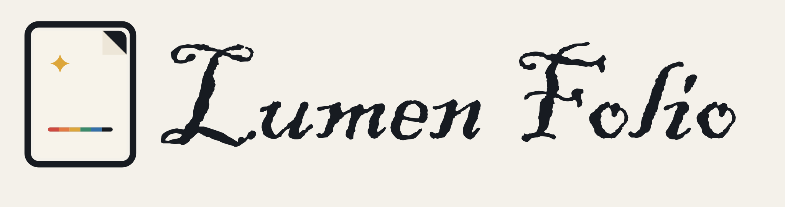

# LumenFolio

LumenFolio 是基于 ESP32-S3 和 7.09 英寸六色电子纸的低功耗相框。电子纸断电后仍保留画面。

## 使用相框

- [第一次传图](docs/quickstart.md)：唤醒相框，连接蓝牙或 Wi-Fi，把照片传到屏幕上。
- 配套应用：[Windows](docs/preview.md)、[Android](app/android/README.md)、[微信小程序](app/miniprogram/README.md)。
- [蓝牙连接与排查](docs/bluetooth.md)、[机身按键](docs/控制接口.md#按键)、[指示灯](docs/灯语设计.md)。
- [固件 OTA](docs/ota.md)：用应用或命令行更新相框固件。

## 开发与维护

- [固件构建与有线部署](docs/firmware.md)、[配套应用开发与回归测试](docs/development.md)、[CI 与发布](docs/release.md)。
- [相框 HTTP 和串口控制接口](docs/控制接口.md)、[帧格式](docs/frames.md)、[六色抖动](docs/dither.md)。
- [低功耗与深睡](docs/低功耗.md)、[原理图](原理图.png)、[板级引脚](main/board_pins.h)、[电子纸驱动](components/epd709/README.md)。
- [品牌素材](assets/branding/README.md)。
